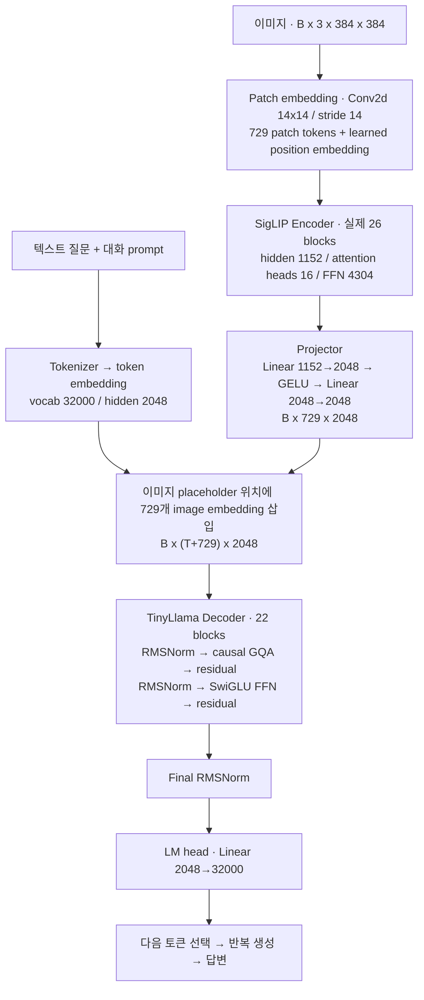

# TinyLLaVA-1.5B 구조와 체크포인트

원본: [TinyLLaVA 논문](https://arxiv.org/abs/2402.14289),
[체크포인트](https://huggingface.co/bczhou/TinyLLaVA-1.5B),
[별도 Vision Encoder](https://huggingface.co/bczhou/TinyLLaVA-1.5B-SigLIP).
다운로드 Revision·파일별 SHA256은 각각 `TinyLLaVA-1.5B_snapshot.json`,
`TinyLLaVA-1.5B-SigLIP_snapshot.json`에 고정한다. 최종 헤더 분석은 `*_analysis.json` 참조.

| 구성 | 실제 체크포인트/공식 코드 기준 |
| --- | --- |
| LLM | TinyLlama 1.1B, Llama decoder, 1,100,048,384 parameters |
| Decoder | 22 layers, hidden 2048, intermediate 5632, vocab 32000 |
| Attention | query heads 32, KV heads 4 (GQA), head dimension 64 |
| Position/norm | RoPE theta 10000, context 2048, RMSNorm epsilon 1e-5 |
| Vision | SigLIP So400m patch14, 384×384, hidden 1152, intermediate 4304, heads 16 |
| Vision layers | config 27 layers; legacy removes the final block, actual 26 layers (indices 0–25), 397,747,744 parameters |
| Vision tokens | 27×27 = 729 patches; legacy forward uses final hidden state |
| Projector | Linear(1152,2048) → GELU → Linear(2048,2048), both with bias |
| Projector parameters | 6,557,696 |
| Total | 1,504,353,824 parameters |

## 전체 데이터 흐름

`B`는 batch 크기이고 `T`는 이미지 placeholder를 제외한 텍스트 토큰 수다.



Vision encoder에는 causal mask 없이 이미지 patch 간 self-attention을 적용한다.
각 Vision block은 `LayerNorm → Attention → residual → LayerNorm → FFN → residual`이다.
Vision FFN은 `Linear(1152,4304) → GELU(tanh approximation) → Linear(4304,1152)`이다.

LLM attention은 causal GQA이며 Q head 32개, K/V head 각 4개, head dimension 64다.
Q projection은 2048→2048, K/V projection은 각각 2048→256, output projection은 2048→2048이다.
Q/K에는 RoPE를 적용한다. LLM FFN은 다음 SwiGLU 계산을 수행한다.

```python
ffn_output = down_proj(silu(gate_proj(x)) * up_proj(x))
# gate_proj / up_proj: 2048 → 5632
# down_proj: 5632 → 2048
```

이미지 특징과 텍스트는 같은 decoder 입력 시퀀스로 합쳐진다.
Projector에는 attention이 없으며 두 Linear와 GELU를 사용한다.
전체 입력과 생성 토큰을 합친 context 상한은 2048이다.

## VSCode에서 전체 모듈 트리 보기

[모듈 트리](model_architecture_tree.txt)에 실제 legacy 클래스에서 생성한 `print(model)` 구조를 저장했다.
다음 명령으로 다시 확인할 수 있다.

```bash
source scripts/env.sh
python scripts/show_model_architecture.py
```

이 명령은 로컬 config와 클래스 정의로 meta tensor 구조를 만들며 가중치 파일이나 GPU 메모리를
읽지 않는다. 출력되는 모듈 이름과 parameter shape를 코드 탐색에 사용한다.
Vision layer의 실제 개수 26, decoder layer 22, 전체 parameter 1,504,353,824를 확인했다.

연결 코드는 `third_party/TinyLLaVA_Factory_legacy/tinyllava/model/language_model/llava_llama.py`의
`TinyLlavaLlamaForCausalLM`과 `tinyllava/model/llava_arch.py`의
`prepare_inputs_labels_for_multimodal`에서 읽을 수 있다.

```
image → pad/resize/normalize → SigLIP [729,1152]
      → 2-layer MLP [729,2048]
      → replace <image> sentinel (-200) in the token sequence
      → TinyLlama 22 decoder layers → LM head → answer
```

주의: 메인 모델 Config에는 `torch_dtype=float16`이지만 실제 메인 safetensors 헤더는 **F32**이다.
FP16 baseline은 공식 로더의 FP16 변환으로 실행한다. 원본 파일은 수정하지 않는다.
별도 SigLIP safetensors는 F16이며, 메인에 포함된 F32 Vision tensor 421개와 수치가 모두
동일함을 CPU 비교로 확인했다 (`vision_weight_comparison.json`).
이 체크포인트의 순수 FP16 가중치는 약 2.80 GiB이다. KV cache, attention/vision activations,
CUDA context와 allocator 메모리를 더해야 하므로 이 수치는 실제 Peak VRAM이 아니다.

전체 체크포인트에는 `model.vision_tower.vision_tower.*`도 포함되어 있다. 별도 SigLIP 저장소는
vision-only 모델이며 공식 legacy 로더가 delay-load 과정에서 사용하므로 함께 보관한다.
메인 체크포인트의 layer count와 vision-only 파일의 key/shape 대응도 최종 검사한다.

## 실행 코드 선택

현재 Factory main의 `TinyLlavaForConditionalGeneration`과 요청한 legacy 체크포인트는
같은 state_dict/config 형식이 아니다. 제공된 변환기는 GPU `safe_open(device=0)`을 사용하며
다른 tokenizer/config 다운로드도 유발할 수 있다. 이번 작업은 변환을 하지 않고 공식
`tinyllava_bench` 브랜치의 `load_pretrained_model`을 사용한다.

`scripts/runtime.py`에서 로딩 직전 메모리의 `mm_vision_tower`만 로컬 SigLIP 경로로 바꾼다.
모든 tokenizer/weight 로딩은 offline으로 검증한다. `model/`의 원본 Config는 보존한다.
Prompt template은 모델 카드가 지정한 `v1`이다. Factory main의 `tinyllama` template을
아무 확인 없이 섞으면 평가 조건이 바뀐다.

legacy SigLIP 구현은 Config의 `mm_vision_select_layer=-2`와 달리 실제 forward에서
마지막 encoder block을 먼저 제거하고 `hidden_states[-1]`을 사용한다. 따라서 27-layer
설정에서 실제 encoder는 26-layer이며, 원래 encoder의 끝에서 두 번째 block 출력에 대응한다.
Tower는 post_layernorm 이전의 encoder hidden state를 Projector에 전달한다.
pooling head는 Identity로 교체돼 있으며 단일 pooled vector 대신 729개 patch token을 전달한다.
이 동작을 임의로 바꾸지 않는다. 이미지 리사이즈,
pad, token expansion도 공식 `process_images`와 모델 forward를 그대로 사용한다.

## 학습 Recipe의 대응

논문 Appendix B의 TinyLLaVA-share-Sig-TL과 모델 카드의 VQAv2 76.9 / GQA 60.3 /
TextVQA 51.7 / MM-Vet 25.8 / LLaVA-W 60.8이 일치한다. 또한 `training_args.bin`의 pickle을
실행하지 않고 opcode 문자열만 분석한 결과 저장 run 이름에
`tiny-llava-tinyllama-sharegpt4v-unlock-vit-from-12-siglip`가 직접 포함되어 있다.
따라서 공개 1.5B 모델은 **ShareGPT4V 데이터 + share recipe**에 대응한다.
`trainer_state.json`은 SFT 1 epoch / 5,196 steps를 기록한다.
카드 SQA 60.3과 논문 표 60.1은 차이가 있으며, checkpoint별
실행 명령·데이터 hash가 모두 공개된 것은 아니므로 완전한 학습 이력의 독립 검증은 불가능하다.

base는 LLaVA 558K alignment에서 projector만 학습한 뒤 LLaVA mix665K로 LLM/projector를
학습한다. share는 base alignment projector에서 출발해 ShareGPT4V 1.246M에서 vision의
초기 12개 층을 제외한 부분과 LLM/projector를 학습하고 ShareGPT4V mix665K로 SFT한다.
두 데이터 구성의 Annotation을 모두 보존하되, SAM/WebData가 없는 상태를 ShareGPT4V
전체 학습 데이터 완료로 간주하지 않는다. 이후 로컬 학습 smoke 검증은 별도 기록이며,
공개 체크포인트의 원래 학습 이력과 구분한다.
