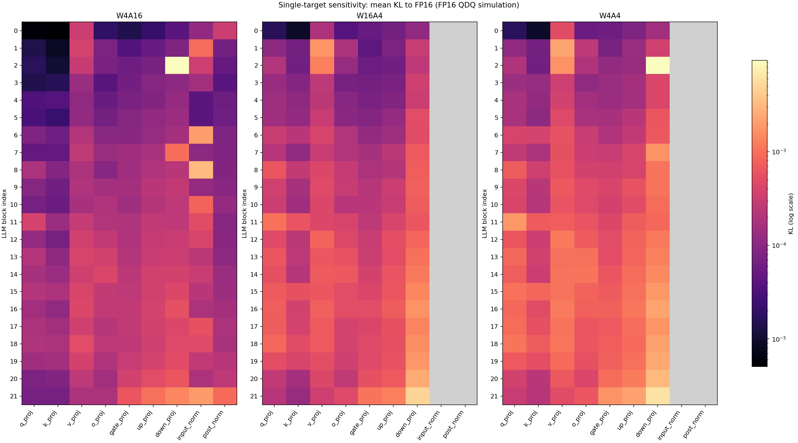
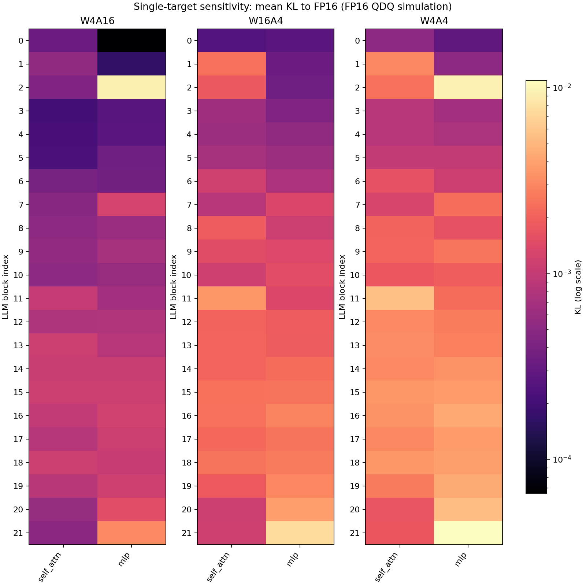

# LLM 레이어별 양자화 민감도

128개 calibration 예제, 643개 단일 대상 개입을 완료했다.
집합 구성: {'discovery': 64, 'confirmation': 64}. 양자화 대상 이외의 Vision·Projector·LLM은 FP16으로 고정했다.
각 개입은 하나의 leaf 또는 하나의 블록 안 Attention/FFN 묶음만 변경한다. 전체 INT4 모델에서 복구한 실험은 아니다.
같은 정답 문맥에서 assistant 토큰만 평가한다. 이미지·사용자 prompt·padding 위치는 점수에서 제외한다.
KL은 FP16 다음 토큰 분포와 비교한 값이며, NLL 변화는 정답 토큰에 대한 손실 차이다. 예제별 평균을 다시 평균한다.
이 점수는 POPE F1·ScienceQA accuracy가 아니며, 최종 벤치마크 개선을 보장하지 않는다.
W/A를 분리하기 위해 같은 FP16 연산에서 INT4 양자화·복원을 시뮬레이션했다. 이 실행의 시간·메모리는 속도 비교에 사용하지 않는다.
A4는 Linear 입력에만 적용한다. RMSNorm·embedding의 A4 점수는 정의하지 않았다.
가중치는 기존 group 128 RTN 체크포인트를 읽었으며 학습·LoRA·optimizer update는 없다.
FP16 파라미터 복구와 개입 전후 FP16 출력 일치를 검증했다.

## 개별 레이어 순위

순위는 discovery 집합의 KL로 정하고, 별도 confirmation 집합의 값을 나란히 표시한다.

### W4A16 — 상위 10개

두 집합의 top-10 공통 레이어는 9개다.

| 레이어 | Discovery KL | Confirmation KL | 전체 ΔNLL | 파라미터 M |
| --- | ---: | ---: | ---: | ---: |
| `model.layers.2.mlp.down_proj` | 0.0090373 | 0.00967213 | +0.0030421 | 11.534 |
| `lm_head` | 0.00705919 | 0.00710268 | +0.00588897 | 65.536 |
| `model.layers.8.input_layernorm` | 0.00334383 | 0.00319158 | -0.00028729 | 0.002 |
| `model.layers.21.input_layernorm` | 0.0019822 | 0.00194163 | +0.00471341 | 0.002 |
| `model.layers.6.input_layernorm` | 0.00188982 | 0.00215575 | -0.00423482 | 0.002 |
| `model.layers.21.mlp.down_proj` | 0.00144925 | 0.00140959 | +0.00282005 | 11.534 |
| `model.layers.7.mlp.down_proj` | 0.00141693 | 0.00050498 | -0.00244 | 11.534 |
| `model.norm` | 0.00137305 | 0.00126995 | +0.00491736 | 0.002 |
| `model.layers.21.mlp.up_proj` | 0.00095452 | 0.00101506 | +4.54652e-05 | 11.534 |
| `model.layers.21.post_attention_layernorm` | 0.000948481 | 0.000885 | +0.00308106 | 0.002 |

### W16A4 — 상위 10개

두 집합의 top-10 공통 레이어는 9개다.

| 레이어 | Discovery KL | Confirmation KL | 전체 ΔNLL | 파라미터 M |
| --- | ---: | ---: | ---: | ---: |
| `lm_head` | 0.0164132 | 0.0164069 | +0.0119856 | 65.536 |
| `model.layers.21.mlp.down_proj` | 0.00463431 | 0.00501423 | +0.00505572 | 11.534 |
| `model.layers.20.mlp.down_proj` | 0.00240739 | 0.00248756 | +0.00104955 | 11.534 |
| `model.layers.19.mlp.down_proj` | 0.0017812 | 0.00193985 | +0.00166502 | 11.534 |
| `model.layers.16.mlp.down_proj` | 0.00172809 | 0.00177131 | +0.00155622 | 11.534 |
| `model.layers.1.self_attn.v_proj` | 0.00157754 | 0.00197125 | -0.0044665 | 0.524 |
| `model.layers.18.mlp.down_proj` | 0.00149395 | 0.00171684 | +0.00213682 | 11.534 |
| `model.layers.15.mlp.down_proj` | 0.00142639 | 0.00143687 | +0.00229762 | 11.534 |
| `model.layers.21.mlp.up_proj` | 0.00132009 | 0.00129716 | +0.00279808 | 11.534 |
| `model.layers.17.mlp.down_proj` | 0.00129379 | 0.0014717 | +0.00130247 | 11.534 |

### W4A4 — 상위 10개

두 집합의 top-10 공통 레이어는 9개다.

| 레이어 | Discovery KL | Confirmation KL | 전체 ΔNLL | 파라미터 M |
| --- | ---: | ---: | ---: | ---: |
| `lm_head` | 0.0238025 | 0.0236708 | +0.0185618 | 65.536 |
| `model.layers.2.mlp.down_proj` | 0.00906526 | 0.00982754 | +0.00411684 | 11.534 |
| `model.layers.21.mlp.down_proj` | 0.00612872 | 0.00622815 | +0.00777704 | 11.534 |
| `model.layers.20.mlp.down_proj` | 0.00301199 | 0.00317977 | +0.00331529 | 11.534 |
| `model.layers.19.mlp.down_proj` | 0.00228651 | 0.00252932 | +0.0027512 | 11.534 |
| `model.layers.16.mlp.down_proj` | 0.00225948 | 0.00233535 | +0.00261694 | 11.534 |
| `model.layers.21.mlp.up_proj` | 0.00222102 | 0.00223799 | +0.00284761 | 11.534 |
| `model.layers.7.mlp.down_proj` | 0.00218516 | 0.00115586 | -0.000708149 | 11.534 |
| `model.layers.1.self_attn.v_proj` | 0.00213668 | 0.00236689 | -0.00312063 | 0.524 |
| `model.layers.18.mlp.down_proj` | 0.00196442 | 0.00226556 | +0.00128039 | 11.534 |

## 블록 안 Attention과 FFN 묶음

각 블록의 Attention projection 전체 또는 FFN projection 전체를 함께 바꾼 경우다.
FFN과 Attention은 파라미터 수가 다르므로 아래 원시 KL은 같은 저장 비용의 비교가 아니다.

| 모드 | 묶음 | 블록 수 | KL 중앙값 | ΔNLL 중앙값 | 블록당 파라미터 M |
| --- | --- | ---: | ---: | ---: | ---: |
| W4A16 | attention | 22 | 0.000533465 | -0.000264393 | 9.437 |
| W4A16 | ffn | 22 | 0.000823511 | +2.70013e-05 | 34.603 |
| W16A4 | attention | 22 | 0.00180185 | +0.0014628 | 9.437 |
| W16A4 | ffn | 22 | 0.00144918 | +0.00171366 | 34.603 |
| W4A4 | attention | 22 | 0.00222601 | -0.000261801 | 9.437 |
| W4A4 | ffn | 22 | 0.00260077 | +0.00137051 | 34.603 |

## 블록 위치별 비교

개별 projection의 KL 중앙값이다. 앞(0–6), 중간(7–14), 뒤(15–21)를 비교하며 Norm·embedding·head는 제외한다.

| 모드 | 위치 | 개별 projection 수 | KL 중앙값 |
| --- | --- | ---: | ---: |
| W4A16 | 앞 | 49 | 7.09663e-05 |
| W4A16 | 중간 | 56 | 0.000198435 |
| W4A16 | 뒤 | 49 | 0.000274779 |
| W16A4 | 앞 | 49 | 0.000116166 |
| W16A4 | 중간 | 56 | 0.000402439 |
| W16A4 | 뒤 | 49 | 0.000546551 |
| W4A4 | 앞 | 49 | 0.000175736 |
| W4A4 | 중간 | 56 | 0.000596377 |
| W4A4 | 뒤 | 49 | 0.000879367 |

## 실제 INT4 커널 확인

Discovery W4A4 상위 leaf를 기존 native 커널로 교체해 같은 조건에서 재측정했다. 나머지 모델은 FP16이다.

| 레이어 | QDQ 전체 KL | Native 전체 KL |
| --- | ---: | ---: |
| `lm_head` | 0.0237367 | 0.0237354 |
| `model.layers.2.mlp.down_proj` | 0.0094464 | 0.00942292 |
| `model.layers.21.mlp.down_proj` | 0.00617843 | 0.00617906 |

## Heatmap

색은 최종 출력 KL이다. 큰 값일수록 이번 조건에서 출력 변화가 크다. 회색은 해당 조건을 적용하지 않은 칸이다.

원자료: `run.json`, `baseline.json`, `measurements.jsonl`, `ranking.csv`, `native_checks.json`, `summary.json`.
집합 간 순위가 안정적인 대상을 후속 calibration 개선 후보로 삼고, 최종 설정은 별도 전체 평가로 확인한다.

## 실행 경로 검증

오른쪽 padding을 사용하고 유효한 정답 위치만 평가하므로, 미래의 padding을 명시적으로 가리는 mask를 생략해 causal SDPA 경로를 사용했다. 모든 개입과 FP16 기준에 같은 경로를 적용했다.
공개 masked forward와 비교한 첫 8개 예제의 평균 KL 차이는 5.16486e-06였다. 어휘 head에 입력하는 행 수도 달라질 수 있어 공개 forward와의 bit 일치를 주장하지 않는다.
재사용한 FP16 prefix와 head 입력은 첫 배치에서 재계산 결과와 bit 단위로 일치했다. 전체 128개 예제의 개입 전후 FP16 출력은 정확히 일치했고 파라미터 hash도 복구됐다.
이 분석은 FP16 나머지 모델에서 단일 대상을 바꾼 민감도이며, 전체 INT4 모델에서 한 레이어를 복구한 성능 변화와는 구분한다.

## Projection별 집계

22개 블록의 개별 레이어를 집계했다. 평균과 중앙값 차이가 크면 일부 블록의 큰 영향이 평균을 끌어올린 경우다.

| 모드 | Projection | KL 중앙값 | KL 평균 | 최대 KL 블록 |
| --- | --- | ---: | ---: | ---: |
| W4A16 | down_proj | 0.000318257 | 0.000791269 | 2 |
| W4A16 | gate_proj | 0.000174633 | 0.000190899 | 21 |
| W4A16 | input_layernorm | 0.000289259 | 0.00060261 | 8 |
| W4A16 | k_proj | 6.84459e-05 | 8.20092e-05 | 18 |
| W4A16 | o_proj | 0.00016994 | 0.000173832 | 14 |
| W4A16 | post_attention_layernorm | 0.000100356 | 0.000160387 | 21 |
| W4A16 | q_proj | 8.6815e-05 | 0.000113578 | 11 |
| W4A16 | up_proj | 0.000257694 | 0.000269946 | 21 |
| W4A16 | v_proj | 0.000287021 | 0.000285187 | 18 |
| W16A4 | down_proj | 0.0007548 | 0.00109662 | 21 |
| W16A4 | gate_proj | 0.000241981 | 0.00029603 | 21 |
| W16A4 | k_proj | 0.000190435 | 0.000237439 | 11 |
| W16A4 | o_proj | 0.000292015 | 0.000307631 | 14 |
| W16A4 | q_proj | 0.000341732 | 0.000424004 | 11 |
| W16A4 | up_proj | 0.000363588 | 0.000401367 | 21 |
| W16A4 | v_proj | 0.000456265 | 0.00057901 | 1 |
| W4A4 | down_proj | 0.00123174 | 0.00188516 | 2 |
| W4A4 | gate_proj | 0.000421549 | 0.000488912 | 21 |
| W4A4 | k_proj | 0.000276274 | 0.000326189 | 15 |
| W4A4 | o_proj | 0.000472893 | 0.000488635 | 14 |
| W4A4 | q_proj | 0.000424126 | 0.000562521 | 11 |
| W4A4 | up_proj | 0.000656191 | 0.000671997 | 21 |
| W4A4 | v_proj | 0.000703144 | 0.000867376 | 1 |

## Attention·FFN의 예제별 대응 비교

같은 예제에서 22개 블록의 Attention 묶음 KL 평균과 FFN 묶음 KL 평균을 비교했다.
FFN−Attention 값이 양수면 이번 개입에서 FFN의 출력 변화가 더 컸다는 뜻이다. 파라미터 수·저장 비용을 맞춘 비교는 아니다.
95% 구간은 예제를 5,000번 복원 추출한 paired bootstrap이다. 고정된 모델·calibration 분포에 대한 변동이며 전체 과제 정확도의 신뢰구간이 아니다.

| 모드 | 집합 | Attention 평균 KL | FFN 평균 KL | FFN−Attention | 95% 구간 |
| --- | --- | ---: | ---: | ---: | --- |
| W4A16 | all | 0.000649769 | 0.00125117 | +0.000601398 | [+0.000497044, +0.000713811] |
| W4A16 | discovery | 0.00064628 | 0.00126044 | +0.000614165 | [+0.000475072, +0.000780802] |
| W4A16 | confirmation | 0.000653258 | 0.00124189 | +0.000588632 | [+0.000449123, +0.000745016] |
| W16A4 | all | 0.0016467 | 0.00185563 | +0.000208931 | [+6.57293e-05, +0.000335533] |
| W16A4 | discovery | 0.00163442 | 0.0018132 | +0.000178773 | [-2.10409e-05, +0.000326337] |
| W16A4 | confirmation | 0.00165897 | 0.00189806 | +0.00023909 | [+2.72624e-05, +0.000416591] |
| W4A4 | all | 0.00237656 | 0.00318335 | +0.000806786 | [+0.00055102, +0.00102938] |
| W4A4 | discovery | 0.00230813 | 0.00314644 | +0.00083831 | [+0.000589681, +0.00106705] |
| W4A4 | confirmation | 0.00244499 | 0.00322025 | +0.000775263 | [+0.000321953, +0.00114762] |
